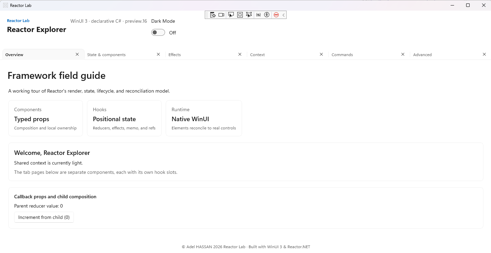
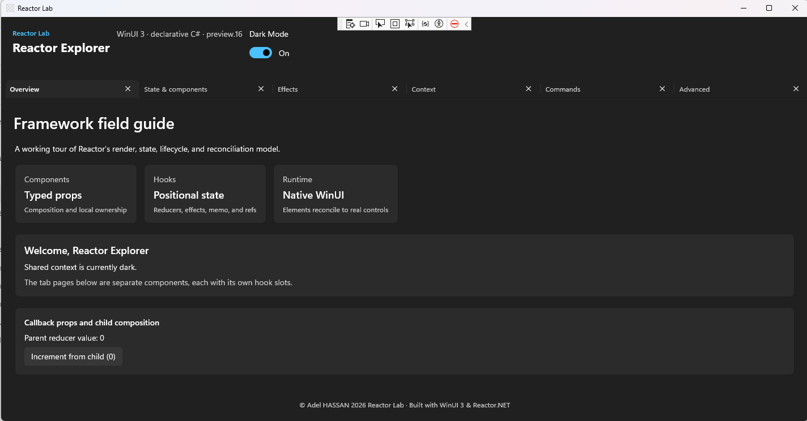

# Reactor Lab
[](https://learn.microsoft.com/windows/apps/winui/)
[](https://dotnet.microsoft.com/)
[](https://www.nuget.org/packages/Microsoft.UI.Reactor/0.1.0-preview.16)
[](https://www.microsoft.com/windows)

**A hands-on WinUI 3 field guide to declarative C# UI with Microsoft.UI.Reactor.**

Reactor Lab is an interactive Windows desktop application for exploring the component, state, lifecycle, and composition patterns available in Microsoft.UI.Reactor. It is an educational sample built on the experimental `0.1.0-preview.16` package.

## Screenshots

| Light theme | Dark theme |
| --- | --- |
|  |  |

## About the project

[Microsoft.UI.Reactor](https://github.com/microsoft/microsoft-ui-reactor) brings a declarative, component-based programming model to WinUI 3. Instead of describing UI in XAML, components return typed C# elements. Reactor reconciles those descriptions into native WinUI controls, while hooks keep state and side effects close to the components that use them.

This project puts that model into practice through a tabbed collection of focused examples. It demonstrates local state and reducers, effect cleanup, context providers, asynchronous commands, memoization, observable data, and contained render errors. The application is intended as a learning and experimentation resource; Reactor is an experimental preview, not a production-readiness guarantee.

## Tech stack

| Area                  | Technologies and concepts                                                                   |
| --------------------- | ------------------------------------------------------------------------------------------- |
| Language and runtime  | C#, .NET 10                                                                                 |
| Desktop UI            | WinUI 3, Windows App SDK                                                                    |
| Declarative UI        | Microsoft.UI.Reactor `0.1.0-preview.16`, component composition, typed props, keyed elements |
| State and hooks       | `UseState`, `UseReducer`, `UseMemo`, `UseCallback`, `UseRef`                                |
| Effects and lifecycle | `UseEffect`, dependency-driven updates, cancellation, cleanup on replacement and unmount    |
| Shared data           | Context providers and consumers with `UseContext`                                           |
| Commanding            | `UseCommand`, asynchronous execution, command availability, keyboard accelerators           |
| Advanced patterns     | `UseObservableTree`, memoized subtrees, `ErrorBoundary`, keyed retry                        |
| Packaging             | Single-project MSIX support and Windows app manifests                                       |

## Architecture and solution structure

The application is a single .NET project. `ReactorLab.cs` defines the root component, the shared header and footer, and the tab navigation. Each sample page lives in its own C# file, keeping the example-specific state and UI together. `AppContexts.cs` defines shared settings context and theme brushes.

| File                   | Responsibility                                                                           |
| ---------------------- | ---------------------------------------------------------------------------------------- |
| `App.cs`               | Starts the Reactor application.                                                          |
| `ReactorLab.cs`        | Root component, overview, shared settings, and tab composition.                          |
| `StatePage.cs`         | Local state, reducers, typed task actions, memoized filtering, and keyed task rows.      |
| `EffectsPage.cs`       | Timer and asynchronous mock request examples, including effect cancellation and cleanup. |
| `ContextPage.cs`       | Context providers, consumers, and a nested provider override.                            |
| `CommandsPage.cs`      | Command execution, availability, progress, and keyboard accelerator example.             |
| `AdvancedPage.cs`      | Mutable refs, observable model bridge, memoized subtree, and error boundary recovery.    |
| `AppContexts.cs`       | Settings context and shared theme brushes.                                               |
| `ReactorLab.csproj`    | Target framework, WinUI settings, and NuGet package references.                          |
| `Package.appxmanifest` | Windows package identity, visual assets, and target device declarations.                 |

The tabs are **Overview**, **State & components**, **Effects**, **Context**, **Commands**, and **Advanced**. Each page is a separate Reactor component. The root component supplies shared settings context; individual pages own their local state and render logic.

## Getting started

### Prerequisites

- Windows 10 version 1809 (build 17763) or later; the project targets Windows SDK `10.0.26100.0`.
- .NET 10 SDK.
- Windows App SDK / WinUI 3 build prerequisites. Visual Studio with the **WinUI application development** workload is a convenient option; command-line builds use the project’s NuGet package references.
- For creating a new project from the official Reactor template: [Windows App CLI](https://learn.microsoft.com/windows/apps/windows-app-sdk/) (`winapp`).
- For launching a packaged app locally, enable **Developer Mode** in Windows Settings.

### Build and run this project

Open a terminal in the directory containing `ReactorLab.csproj`, then restore and build for an explicit Windows platform:

```powershell
dotnet restore .\ReactorLab.csproj
dotnet build .\ReactorLab.csproj -p:Platform=x64
```

Run the app:

```powershell
dotnet run --project .\ReactorLab.csproj -p:Platform=x64
```

Use `ARM64` or `x86` instead of `x64` when building for those platforms. The project also includes Visual Studio launch profiles for packaged, unpackaged, and unpackaged-with-devtools execution. The DevTools launch profile is for Debug builds.

### Create a new Reactor project

Install the Windows App CLI if it is not already available:

```powershell
winget install Microsoft.WinAppCli
```

Create and run an app from the official Reactor template:

```powershell
winapp new -t reactor -n MyReactorApp
cd .\MyReactorApp
dotnet run -p:Platform=x64
```

To see the other available Windows App SDK templates:

```powershell
winapp new --list
```

The template pack may scaffold against a newer Reactor package than the preview used by this lab. To reproduce this project's dependency version, set the generated project's `Microsoft.UI.Reactor` package reference to `0.1.0-preview.16`. The template is maintained by the Windows App SDK; see the [Microsoft.UI.Reactor repository](https://github.com/microsoft/microsoft-ui-reactor) for current template and framework guidance.

## Working with the examples

1. Launch the app and start on **Overview** for a brief introduction to components, hooks, and shared settings.
2. Select **State & components** to add, filter, complete, and remove tasks while examining reducer-driven state transitions.
3. Use **Effects** to start and stop a timer or refresh mock telemetry; switch tabs or trigger refreshes to see effect cleanup.
4. Open **Context** to change settings and compare the nested provider override with the inherited value.
5. Try **Commands** to run the asynchronous command, reset its state, or simulate an error.
6. Use **Advanced** to explore refs, observable updates, memoization, and recovery from a deliberately contained rendering error.

## Preview status

Microsoft.UI.Reactor `0.1.0-preview.16` is a prerelease dependency. APIs and behavior may change between preview releases. This repository is a learning lab, not a statement of framework stability or production support.

## 👤 Author

**Adel Hassan** · Enterprise .NET Architect & Open Source Maintainer  
📧 adel_alfa@hotmail.com  
🐙 [GitHub](https://github.com/Adel-alfa)  
💼 [LinkedIn](https://linkedin.com/in/adel-hassan-ly)
